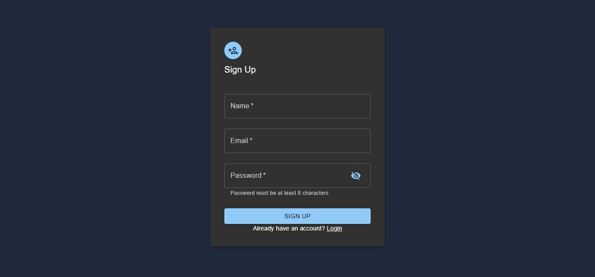
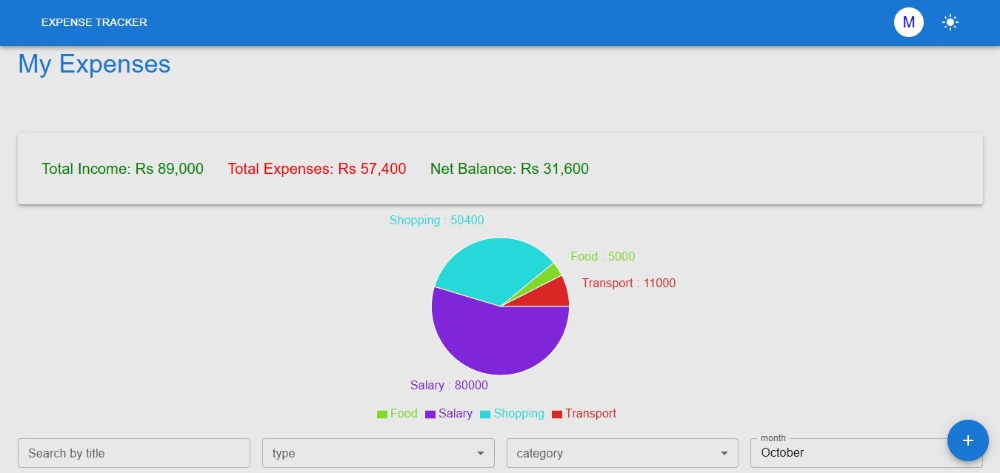
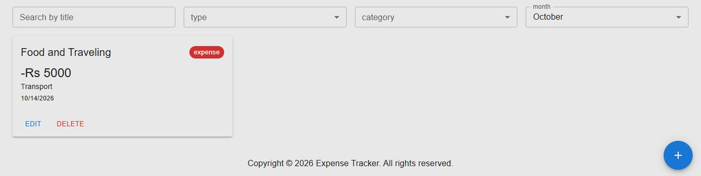
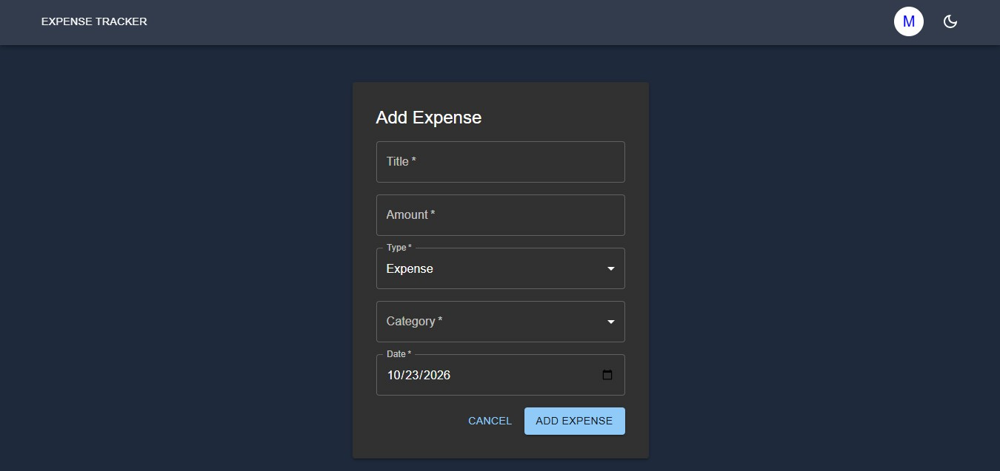
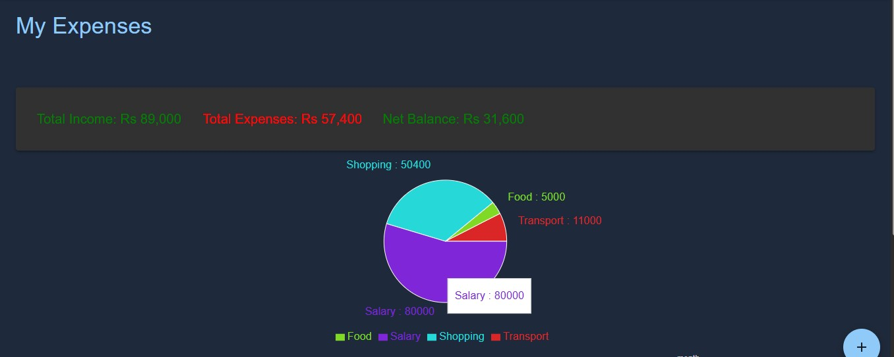

# Expense-Tracker

A full-stack expense tracker built with the MERN stack. Users can record their income and expenses, view a summary and a category-wise chart, and edit or delete entries anytime. Each user only sees their own data, and authentication is handled with JWT.

**Live Demo:** []
**Backend API:** []


## Features

### Expense Management
- Add income or expense entries with title, amount, type, category and date
- Edit or delete any entry
- Categories: Food, Transport, Bills, Shopping, Salary, Other

### Dashboard
- Summary card showing total income, total expenses and net balance
- Pie chart showing the amount spent or earned per category
- Search by title and filter by type, category and month

### Authentication & Security
- Register and log in with JWT authentication, passwords hashed with bcrypt
- Email is trimmed and lowercased, so the same email can't register twice in different cases
- Client-side and server-side validation (required fields, email format, minimum password length)
- Protected routes on both frontend and backend
- Show/hide password toggle

### UI
- Light and dark mode toggle
- Responsive Layout built with Material UI

## Tech Stack

**Frontend:** React (Vite), Zustand, React Router, Material UI, Axios
**Backend:** Node.js, Express.js
**Database:** MongoDB Atlas with Mongoose
**Authentication:** JSON Web Tokens (JWT), bcryptjs
**Deployment:** Vercel (frontend and backend deployed as separate projects)

## Project Structure
```
expense-tracker/
├── client/     # React frontend
└── server/     # Express backend (routes, controllers, models, middleware)
```

## API Overview

| Route              | Description                       |
|--------------------|-----------------------------------|
| `/api/users`       | Register and login                |
| `/api/expense`     | Add, Edit, Delete and Get Expense |


Protected routes require a `Bearer` token in the `Authorization` header.

## Getting Started

### Prerequisites
- Node.js
- A MongoDB Atlas account (or a local MongoDB instance)

### Installation

```bash
git clone https://github.com/zeenat2026/Expense-Tracker.git
cd Expense-Tracker
```

**Backend**
```bash
cd server
npm install
```
Create a `.env` file in `server/`:
```
MONGO_URI=your_mongodb_connection_string
JWT_SECRET=your_secret_key
PORT=5001
```
```bash
npm run dev
```

**Frontend**
```bash
cd client
npm install
```
Create a `.env` file in `client/`:
```
VITE_API_URL=https://market-hub-backend.vercel.app
```
```bash
npm run dev
```

## Screenshots







## Author
**Zeenat Shafqaat**
[LinkedIn](https://www.linkedin.com/in/zeenat-shafqaat/) · [GitHub](https://github.com/zeenat2026/Expense-Tracker)

